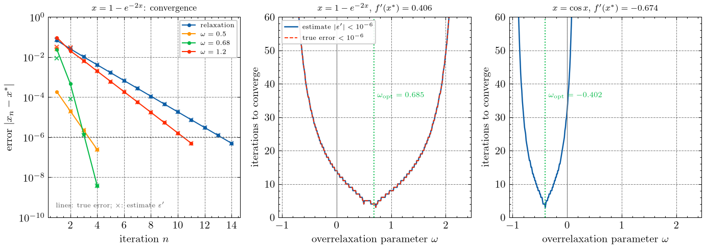
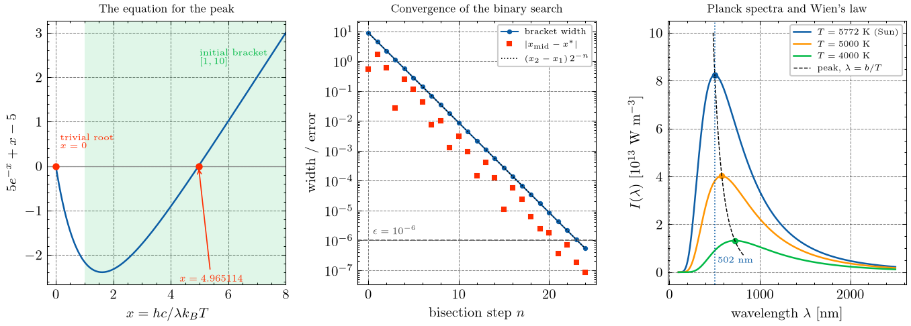
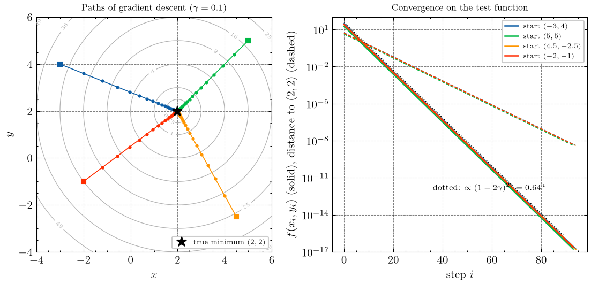
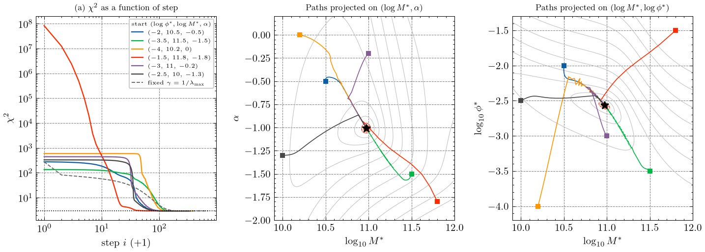
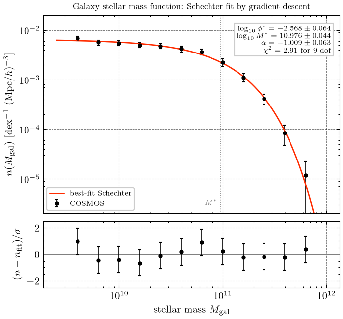

# Computational Physics — Homework 2

Overrelaxation (Newman 6.11), Wien's displacement constant by binary search
(Newman 6.13), and a gradient-descent fit of a Schechter function to the COSMOS
galaxy stellar mass function.

## Running

The project uses [uv](https://docs.astral.sh/uv/). Figures use
[SciencePlots](https://github.com/garrettj403/SciencePlots), and all figure text
is typeset by LaTeX. `plotstyle.py` checks for `latex`, `dvipng`, and the style
files SciencePlots needs, and falls back to matplotlib mathtext if any is
missing. On Arch the requirements come from:

```
paru -S texlive-bin texlive-latexextra texlive-mathscience
```

```
uv sync
uv run python problem1.py
uv run python problem2.py
uv run python problem3.py
```

Figures are written to `figs/` and printed output is saved in `results/`. The
homework writeup (Summary / Methods / Results / Code) is
[`writeup/hw2_writeup.pdf`](writeup/hw2_writeup.pdf), built from
`writeup/hw2_writeup.tex` with `latexmk -pdf`.

| file | contents |
| --- | --- |
| `plotstyle.py` | shared SciencePlots configuration |
| `problem1.py` | relaxation and overrelaxation for x = 1 − exp(−2x), and x = cos x |
| `problem2.py` | binary search for 5e^(−x) + x − 5 = 0, Wien's constant, the Sun's temperature |
| `problem3.py` | gradient descent with numerical derivatives; Schechter fit to the stellar mass function |
| `smf_cosmos.dat` | supplied data (columns: log M_gal, n(M_gal) [1/dex/(Mpc/h)^3], error) |

---

## Problem 1 — overrelaxation (Newman 6.11)

Overrelaxation iterates x' = (1 + ω) f(x) − ω x. Linearising about the solution
x* gives ε' = g ε with g = (1 + ω) f'(x*) − ω, and hence the error estimate

ε' ≈ (x − x') / (1 − 1 / [(1 + ω) f'(x*) − ω]),

which reduces to the relaxation formula for ω = 0. It is used as the stopping
criterion (with f' evaluated at the current iterate). Convergence is fastest
for g = 0, i.e. **ω_opt = f'(x*) / (1 − f'(x*))**.



For x = 1 − exp(−2x): x* = 0.796812, f'(x*) = 0.406, ω_opt = 0.685. Starting
from x0 = 1:

| ω | g | iterations to 1e-6 | true error |
| --- | --- | --- | --- |
| 0 (relaxation) | +0.41 | 14 | 5.0e-07 |
| 0.25 | +0.26 | 9 | 6.1e-07 |
| 0.50 | +0.11 | 4 | 2.4e-07 |
| 0.70 | −0.01 | 4 | 2.2e-08 |
| 0.72 | −0.02 | 3 | 3.9e-08 |
| 1.00 | −0.19 | 8 | 3.9e-07 |
| 1.50 | −0.48 | 17 | 8.9e-07 |

Overrelaxation near ω_opt converges in 3–4 iterations instead of 14. Stopping on
the error estimate gives exactly the same iteration count as stopping on the
true error, at every ω in the scan.

**(d) ω < 0.** ω_opt is negative whenever f'(x*) < 0. Relaxation then already
overshoots (the iterates alternate about x*), and ω < 0 damps the overshoot. For
x = cos x (f'(x*) = −0.674, ω_opt = −0.402), relaxation takes 32 iterations,
ω = −0.4 takes 3, and ω = +0.2 already diverges. ω < −1 can also make an
iteration with f'(x*) > 1 converge, where plain relaxation fails.

---

## Problem 2 — Wien's displacement constant (Newman 6.13)

Setting dI/dλ = 0 for Planck's law with x = hc/(λ k_B T) gives
5e^(−x) + x − 5 = 0, so λ_max = b/T with b = hc/(k_B x). Binary search on
[1, 10] (which excludes the trivial root x = 0) with ε = 1e-6:

* 24 steps (= ⌈log2(9/1e-6)⌉), **x = 4.965114** (true error 8.5e-08)
* **b = 2.897772e-03 m K** (±3e-10 from the bisection tolerance)
* λ_max = 502 nm for the Sun → **T_sun = b/λ ≈ 5772 K**



---

## Problem 3 — gradient descent and the Schechter fit

`gradient_descent` steps x → x − γ ∇f with the gradient from central differences
(h = 1e-6). The step γ can be fixed, or adaptive (×1.2 after a successful step,
halved and retried if f would rise), and a maximum step length can be imposed.

**Test** on f(x, y) = (x − 2)² + (y − 2)² with fixed γ = 0.1: from four starts
the walker reaches (2.00000000, 2.00000000) in 93–94 steps, with f falling by
exactly (1 − 2γ)² = 0.64 per step down to 2e-17.



**Fit.** χ² = Σ (n_model − n_data)² / σ² is minimised in
p = (log10 φ*, log10 M*, α). In these variables the Hessian at the minimum has
condition number 51; in linear φ* it is ~1e6. Adaptive γ starting at 1e-6, step
length capped at 0.2 (without the cap, the start with χ² ≈ 8e7 is thrown onto a
plateau where the model is ≈ 0 and the gradient vanishes).



| start (log φ*, log M*, α) | steps | χ² | log10 φ* | log10 M* | α |
| --- | --- | --- | --- | --- | --- |
| (−2.0, 10.5, −0.5) | 343 | 2.908056 | −2.56822 | 10.97623 | −1.00939 |
| (−3.5, 11.5, −1.5) | 381 | 2.908056 | −2.56822 | 10.97623 | −1.00939 |
| (−4.0, 10.2, 0.0) | 373 | 2.908056 | −2.56821 | 10.97623 | −1.00939 |
| (−1.5, 11.8, −1.8) | 287 | 2.908056 | −2.56821 | 10.97623 | −1.00939 |
| (−3.0, 11.0, −0.2) | 346 | 2.908056 | −2.56822 | 10.97623 | −1.00939 |
| (−2.5, 10.0, −1.3) | 327 | 2.908056 | −2.56821 | 10.97623 | −1.00939 |

All six starts agree to 1.6e-6 in every parameter, far below the statistical
errors. A fixed step γ = 1/λ_max also converges, but takes 711 steps.
`scipy.optimize.least_squares` finds the same minimum.

### Result

**log10 φ\* = −2.568 ± 0.064, log10 M\* = 10.976 ± 0.044, α = −1.009 ± 0.063**,
with χ² = 2.91 for 9 dof (errors from Cov = 2 H⁻¹). The reduced χ² of 0.32
suggests that the quoted data errors are conservative or correlated between bins.


